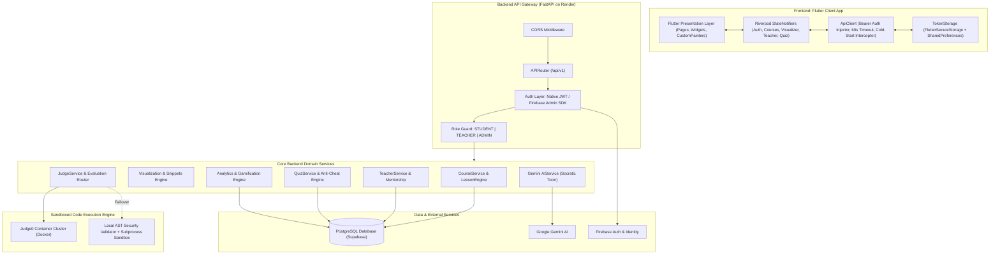

# AlgoVerse — Comprehensive System Architecture & Master Handoff Prompt

> **File Name:** `NEW_HANDOFF_PROMPT.md`  
> **Target Project:** AlgoVerse (`Uday-Mahajan-Dev/AlgoVerse`)  
> **Document Version:** 3.0.0 (Production & Release APK Verified)  
> **Status:** All Features Active, Hardened, Clean Analyzer (0 Issues), Production APK Verified  
> **Live Backend:** `https://algoverse-api-cthi.onrender.com`  
> **Production API Base URL:** `https://algoverse-api-cthi.onrender.com/api/v1`  

---

## 1. Executive Overview & Mission

**AlgoVerse** is an interactive, story-driven, and gamified Data Structures and Algorithms (DSA) learning and classroom management platform. It combines:
1. **Interactive Step-by-Step Visualizations**: Real-time canvas rendering for data structures (arrays, linked lists, trees, graphs) with multi-language code synchronization (Python, Java, C++).
2. **Dual-Tier Sandboxed Code Judge**: Automated multi-language problem evaluation powered by containerized Judge0 with automated fallback to a local AST-guarded Python sandbox.
3. **AI Socratic DSA Tutor**: Google Gemini-powered tutor that provides progressive, 3-level hints without spoiling answers, along with instant runtime error explanation.
4. **Educator Studio & Classroom Management**: Teacher-managed private classrooms with enrollment codes (`ALG-XXXX`), capacity quotas, custom problem creation (with hidden edge test cases), and real-time student analytics.
5. **Gamification & Competitions**: Speed blitz quizzes with decay-rate anti-cheat multipliers, daily streak tracking, XP progression, and tiered achievement badges.
6. **Multi-Role RBAC**: Strict separation and customized experiences for `STUDENT`, `TEACHER`, and `ADMIN`.

---

## 2. Technology Stack & Infrastructure Catalog

### 2.1 Frontend (Flutter / Android / Web / Desktop)
* **SDK**: Flutter 3.x / Dart 3.11.1
* **State Management**: Riverpod (`flutter_riverpod` StateNotifier architecture)
* **Routing**: GoRouter with declarative route guards and deep linking
* **Networking**:
  * Primary: Custom `ApiClient` wrapping `http` and `dio` (with 60-second timeouts and Render cold-start resilience)
  * Base URL Resolution: Enforces `https://algoverse-api-cthi.onrender.com/api/v1` on release APKs (never defaults to `10.0.2.2` in release)
* **Persistence & Storage**:
  * Dual-layer storage: `FlutterSecureStorage` (with `resetOnError: true`) + `SharedPreferences` backup for cold starts
* **Rendering & Visualization**: Custom `Canvas` / `CustomPainter` renderers for dynamic graph, tree, array, and pointer animations
* **Code Editing**: `flutter_code_editor` with syntax highlighting across Python, Java, and C++
* **Authentication**: Dual pipeline (Native JWT authentication + Firebase Google/GitHub Sign-In exchange)

### 2.2 Backend (FastAPI / Python)
* **Framework**: FastAPI (Python 3.12/3.14 compatible, running under Uvicorn)
* **ORM & Database**: SQLAlchemy 2.0+ with PostgreSQL (Supabase Cloud with SSL pooling)
* **Database Migrations**: Alembic (`s1a2b3c4d5e6` head revision)
* **Schema Validation**: Pydantic v2
* **Security & Auth**: Native bcrypt hashing (`passlib[bcrypt]`, `python-jose`) + Firebase Admin SDK for OAuth token verification
* **AI Provider**: Google Gemini API via official SDK (`google-generativeai`) with custom Socratic system prompts
* **HTTP Client**: `httpx` and `requests` for communication with Judge0 and Gemini

### 2.3 Sandboxed Execution Infrastructure
* **Judge0 Sandbox**: Containerized multi-language code execution engine (`judge0/judge0:1.13.1`) orchestrated via Docker Compose (`algoverse_judge0`, `algoverse_judge0_redis`, `algoverse_judge0_db`).
* **Fallback Execution Sandbox**: Local `SubprocessExecutor` guarded by Python `ast.NodeVisitor` (`ASTSecurityValidator`), enforcing strict blocks on forbidden OS calls, subprocesses, sockets, and built-ins (`open`, `eval`, `exec`).

---

## 3. Global System Architecture & Data Flow



---

## 4. End-to-End Feature Flows

### 4.1 Authentication, Session Persistence & RBAC
1. **Login Flow**:
   - User submits email/password or authenticates with Google/GitHub via Firebase.
   - Native endpoint `/api/v1/auth/login` or social exchange `/api/v1/auth/social-login` returns JWT `access_token` and `refresh_token`.
   - `TokenStorage` persists tokens in `FlutterSecureStorage` (with `resetOnError: true`) and mirrors non-sensitive metadata in `SharedPreferences`.
   - In-memory static cache provides synchronous access to prevent token read latency during rapid network calls.
2. **Cold-Start Resilience**:
   - `ApiClient.warmBackend()` fires a lightweight background ping to Render (`$host/docs`) on app and login screen init.
   - Network calls timeout at 60 seconds (giving Render free-tier cold starts sufficient spin-up time).
   - If a timeout occurs, `_guard` and Dio interceptors catch `TimeoutException` and display:
     `"Server is waking up (cold start). Please wait a few seconds and try again."`
   - Login button loading state always resets in a `finally` block, preventing infinite spinners.
3. **Role-Based Routing**:
   - `GoRouter` declarative redirect inspects `AuthState`.
   - Unauthenticated users are routed to `/login`.
   - Authenticated users are redirected based on role:
     - `STUDENT` $\rightarrow$ `/dashboard`
     - `TEACHER` $\rightarrow$ `/teacher-dashboard`
     - `ADMIN` $\rightarrow$ `/admin`

### 4.2 Interactive Visualizer & Multi-Language Code Binding
1. **Workspace Architecture**:
   - Located at `frontend/app/lib/features/learning/presentation/widgets/interactive_visualizer_workspace.dart`.
   - Utilizes `ValueKey` management for reactive language switching between **Python**, **Java**, and **C++** without resetting visualization state.
2. **Synchronized Playback**:
   - `CodeViewerWidget` highlights the active executing line in real time (`Color(0xFF363A4F)` background with gold indicator `Color(0xFFF9E2AF)`).
   - Canvas renderers visualize internal pointers, array elements, tree nodes, or graph edges corresponding to each step.
   - When the user reaches the final step (`_currentStepIndex >= totalSteps - 1`), the lesson automatically marks completion, awards XP, and syncs progress to `/api/v1/courses/{slug}/lessons/{lesson_slug}/complete`.

### 4.3 Sandboxed Code Execution & Online Judge
1. **Dual-Tier Judge Architecture**:
   - Student submits code against problem test cases.
   - `JudgeService` first routes execution to the **Judge0 container cluster**.
   - If Judge0 is offline, times out, or fails, `JudgeService` transparently falls back to the **SubprocessExecutor**.
2. **AST Security Layer**:
   - Subprocess execution is guarded by `ASTSecurityValidator` (`backend/app/services/code_execution/ast_security_validator.py`).
   - Forbids risky AST nodes and builtins: `open`, `eval`, `exec`, `os`, `sys`, `subprocess`, `socket`, `importlib`.
   - Executes Python in an isolated subprocess with strict CPU and memory limits.
3. **Custom Problems & Hidden Edge Tests**:
   - Educators author custom problems via Educator Studio (`/api/v1/custom-problems`).
   - Test cases are split into:
     - **Visible Test Cases**: Visible to students, including detailed explanations.
     - **Hidden Test Cases**: Masked during problem solving; used exclusively during evaluation to prevent hardcoded solutions.

### 4.4 Classroom Capacity & Faculty Mentorship
1. **Classroom Codes & Join Limits**:
   - Teachers generate unique codes (`ALG-XXXX`) with an enforced `max_students` capacity limit.
   - When students join via `/api/v1/teachers/join-classroom`, the system verifies capacity before creating the enrollment record.
2. **Mentorship Lifecycle**:
   - Students submit mentorship requests to faculty via `/api/v1/mentorship/request`.
   - Teachers review, approve, or decline requests from the Teacher Dashboard.
   - Student roster displays real-time course completion percentages and quiz scores.

### 4.5 Competitive Quizzes & Anti-Cheat Engine
1. **Speed Blitz Quizzes**:
   - Timed multiple-choice and code-snippet questions (`/api/v1/quizzes`).
   - Score calculation employs a **time-decay multiplier**: answering quickly yields maximum XP; delayed answers yield decreasing points.
2. **Anti-Cheat Validation**:
   - Submissions monitor tab switching and suspicious completion durations.
   - Leaderboards are computed dynamically with rank ties resolved by completion speed.

### 4.6 AI Socratic DSA Tutor
1. **Progressive Hint Revelation**:
   - Integrated with Google Gemini API via `backend/app/services/ai_service.py`.
   - Generates 3 progressive hint tiers:
     - **Level 1**: Conceptual nudge and algorithmic intuition.
     - **Level 2**: Edge case identification and structural recommendation.
     - **Level 3**: Pseudocode direction (without supplying direct code solutions).
2. **Runtime Code Error Explainer**:
   - When a student's submission produces a compiler or runtime error, the AI analyzes the error output and provides an explanation framed in accessible terms.

---

## 5. API Route Catalog (21 Feature Modules)

| Route Prefix | Primary Purpose | Key Methods |
| :--- | :--- | :--- |
| `/api/v1/auth` | User registration, login, token refresh, Firebase social auth | `POST /register`, `POST /login`, `POST /social-login`, `POST /refresh` |
| `/api/v1/users` | Profile retrieval, user settings, avatar updates | `GET /me`, `PUT /profile`, `GET /stats` |
| `/api/v1/courses` | Course catalog, modules, lessons, lesson completion | `GET /`, `GET /{slug}`, `POST /{slug}/lessons/{lesson_slug}/complete` |
| `/api/v1/problems` | Public DSA problem bank, visible test cases | `GET /`, `GET /{id}`, `POST /{id}/run`, `POST /{id}/submit` |
| `/api/v1/submissions` | Historical code submission lookup and test results | `GET /`, `GET /{id}` |
| `/api/v1/custom-problems` | Educator custom problem creation & student solving | `GET /`, `POST /`, `GET /{id}`, `POST /{id}/submit` |
| `/api/v1/quizzes` | Timed quizzes, question delivery, quiz submissions | `GET /`, `GET /{id}`, `POST /{id}/submit` |
| `/api/v1/teachers` | Teacher profile, classroom setup, student roster | `GET /catalog`, `POST /classroom`, `GET /students` |
| `/api/v1/mentorship` | Student-faculty mentorship requests & approvals | `POST /request`, `GET /requests`, `PUT /{id}/status` |
| `/api/v1/ai` | Socratic hint retrieval (L1–L3), code error explainer | `POST /hint`, `POST /explain-error` |
| `/api/v1/badges` | Achievement badge catalog and user awarded badges | `GET /`, `GET /my-badges` |
| `/api/v1/professors` | Public faculty directory and student ratings | `GET /`, `GET /{id}`, `POST /{id}/ratings` |
| `/api/v1/analytics` | Topic mastery rates, learning curves, activity heatmaps | `GET /summary`, `GET /topics` |
| `/api/v1/admin` | Platform administration, teacher verification approvals | `GET /educators/pending`, `PUT /educators/{id}/approve` |

---

## 6. Directory Structure & Key Files

```
AlgoVerse/
├── backend/
│   ├── alembic/                         # Database migration scripts
│   ├── app/
│   │   ├── api/v1/                      # 21 API Route modules
│   │   ├── core/                        # Config, security, database session
│   │   ├── models/                      # 34 SQLAlchemy ORM models
│   │   ├── schemas/                     # Pydantic v2 schemas
│   │   ├── services/                    # Domain services (Course, Judge, AI, Quiz)
│   │   │   └── code_execution/          # Judge0Executor + ASTSecurityValidator
│   │   └── main.py                      # FastAPI app entrypoint
│   └── tests/                           # Unit & integration test suite
├── database/                            # SQL seed scripts & schema dumps
├── docs/                                # Technical documentation & API specs
└── frontend/app/
    ├── android/                         # Native Android configuration
    │   ├── app/src/main/AndroidManifest.xml  # Cleartext HTTP + package visibility queries
    │   └── app/build.gradle.kts         # SDK versions, signing & dependencies
    ├── assets/                          # App logos, icons, animations
    └── lib/
        ├── app/
        │   ├── app.dart                 # Root MaterialApp widget
        │   ├── router.dart              # GoRouter route declarations & role guards
        │   └── theme.dart               # Theme system
        ├── core/
        │   ├── constants/               # AppRoutes, AppAssets, AppConstants
        │   ├── network/api_client.dart  # Production Render URL, 60s timeouts, cold start mapper
        │   ├── storage/token_storage.dart # SecureStorage + SharedPreferences
        │   └── theme/                   # Colors, typography, spacing
        └── features/                    # Feature modules (auth, student_dashboard,
                                         # teacher_dashboard, educator_studio, courses,
                                         # quizzes, problems, profile, splash)
```

---

## 7. Operating Rules & Gotchas for Incoming Developers

1. **Production Backend is on Render**:
   - **Render Free-Tier Behavior**: Instances sleep after inactivity. Waking up takes 30–50 seconds.
   - **Never reduce network timeouts below 60 seconds** in `ApiClient` or `AppConstants.requestTimeout`.
   - `ApiClient.warmBackend()` automatically pings `$host/docs` when the app opens.
2. **Base URL Resolution in Release Mode**:
   - `ApiClient.resolveBaseUrl()` is enforced as:
     `static const String productionBaseUrl = 'https://algoverse-api-cthi.onrender.com/api/v1';`
   - Release builds **never** fall back to `10.0.2.2`, `127.0.0.1`, or `localhost`.
3. **Android Keystore & Google Sign-In**:
   - The SHA-1 certificate fingerprint of your signing keystore must match the registered SHA-1 in the Firebase Console under `com.algoverse.app`.
   - If building with a new production keystore, add its SHA-1 fingerprint in Firebase Console to prevent `ApiException: 10` on Google Sign-In.
4. **Android Permissions & Package Visibility**:
   - [AndroidManifest.xml](file:///c:/Users/udayk/AlgoVerse/frontend/app/android/app/src/main/AndroidManifest.xml) contains:
     - `android.permission.INTERNET`
     - `android.permission.ACCESS_NETWORK_STATE`
     - `android:usesCleartextTraffic="true"` (for local HTTP testing)
     - `<queries>` intent filters for `https`, `http`, and `mailto` (required by `url_launcher` on Android 11+).
5. **Virtual Environment for Backend**:
   - Always execute backend commands using the project's virtual environment:
     `backend/.venv/Scripts/python.exe`
6. **Code Quality Standards**:
   - Maintain a clean analysis state: `dart analyze .` must report **0 issues**.
   - Preserve existing comments and docstrings across modified files.

---

## 8. Build, Run & Verification Commands

### Run Backend Locally
```powershell
cd c:\Users\udayk\AlgoVerse\backend
.\.venv\Scripts\python.exe -m uvicorn app.main:app --host 0.0.0.0 --port 8000 --reload
```

### Run Backend Tests
```powershell
cd c:\Users\udayk\AlgoVerse\backend
.\.venv\Scripts\python.exe -m unittest discover tests
```

### Analyze Frontend Code
```powershell
cd c:\Users\udayk\AlgoVerse\frontend\app
dart analyze .
```

### Build Android Debug APK
```powershell
cd c:\Users\udayk\AlgoVerse\frontend\app
flutter build apk --debug
```
*Output:* `frontend/app/build/app/outputs/flutter-apk/app-debug.apk`

### Build Android Production Release APK
```powershell
cd c:\Users\udayk\AlgoVerse\frontend\app
flutter clean
flutter pub get
flutter build apk --release --dart-define=BASE_URL=https://algoverse-api-cthi.onrender.com/api/v1
```
*Output:* `frontend/app/build/app/outputs/flutter-apk/app-release.apk`
