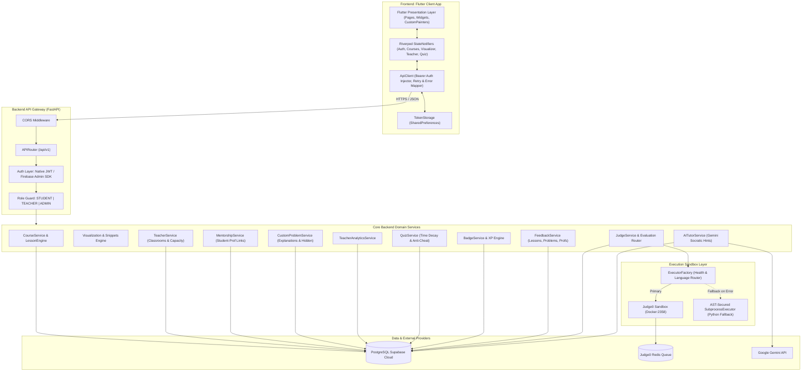
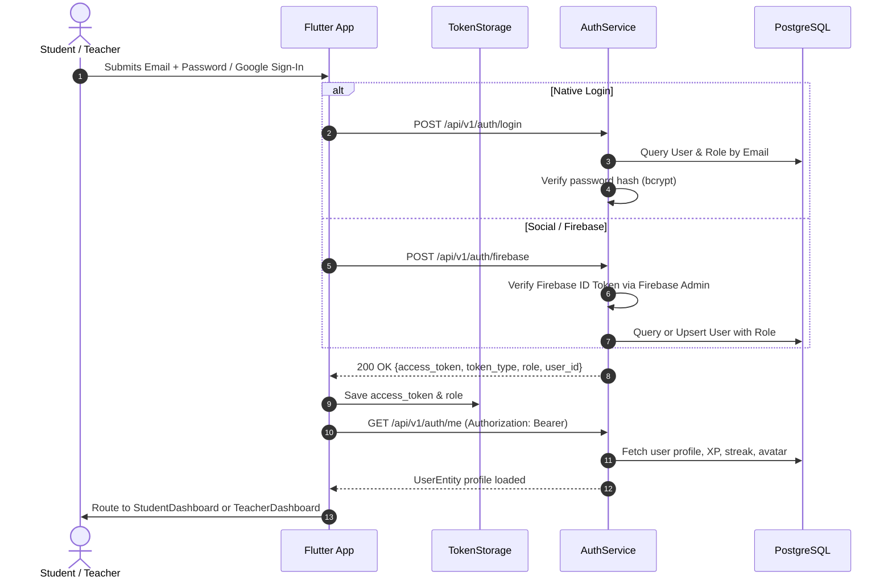
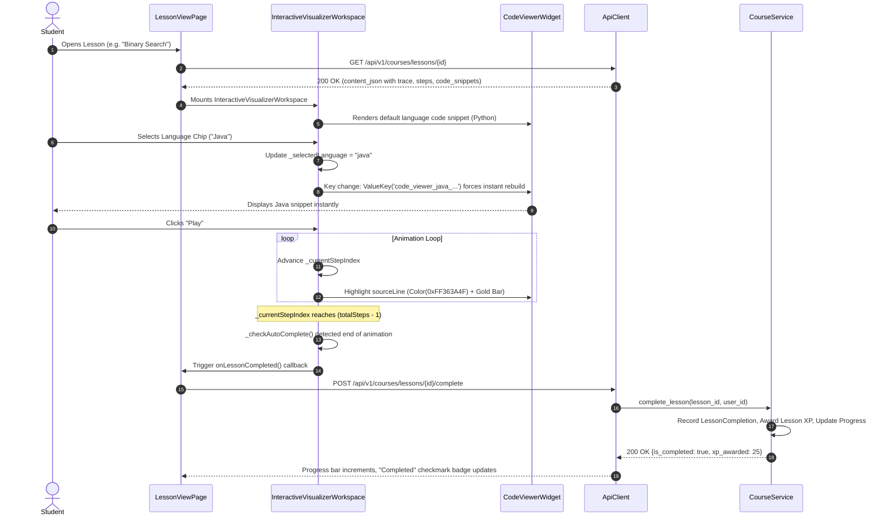
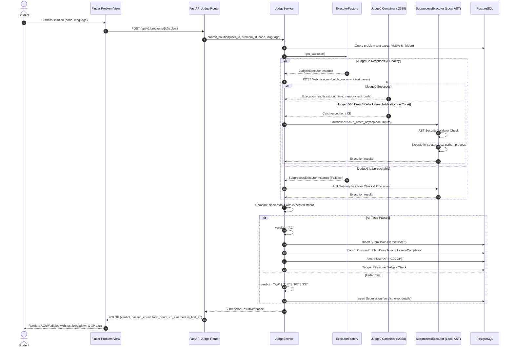
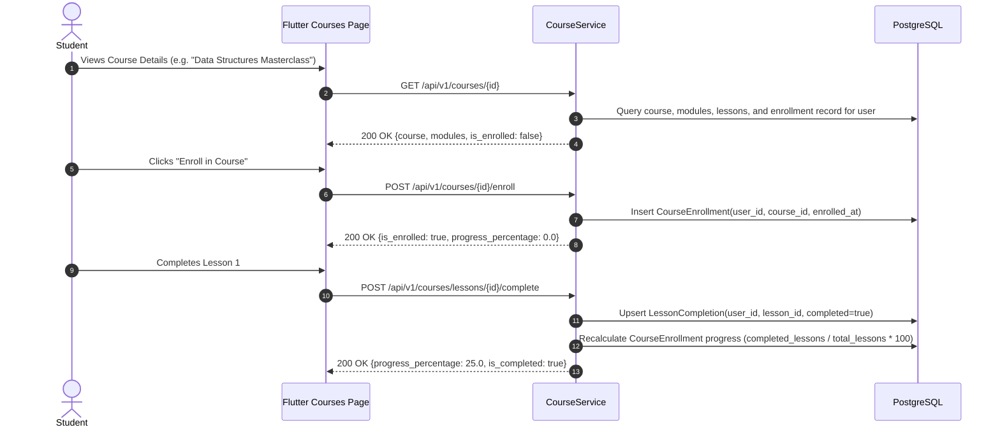
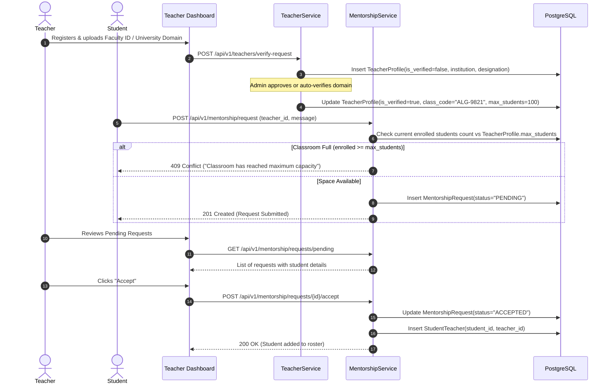
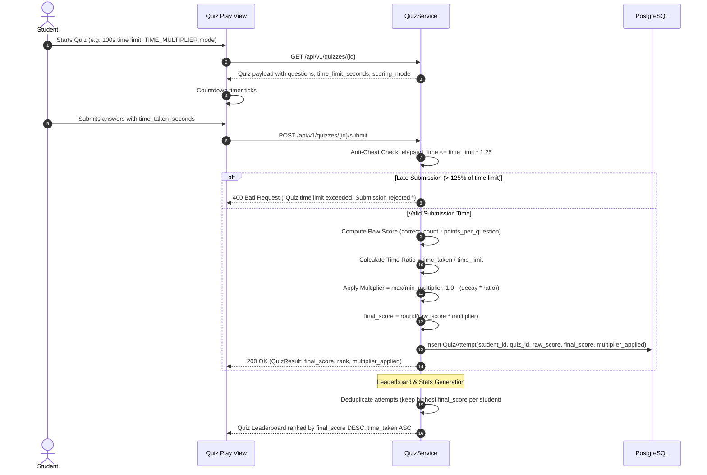
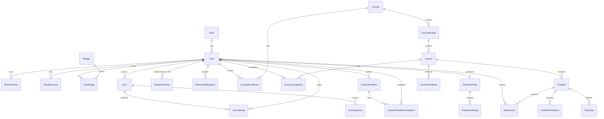

# AlgoVerse AI — Comprehensive Working & Technical Architecture Report

> **Document Version:** 2.0.0 (Production Verified)  
> **Target Project:** AlgoVerse (`Uday-Mahajan-Dev/AlgoVerse`)  
> **Status:** Fully Implemented, Hardened & Analyzed (Phases 1–7 Complete + Verified)  
> **Execution Status:** Flutter Analyze: 0 Issues | Backend Tests: Passing | Head Migration: `s1a2b3c4d5e6`  

---

## Table of Contents

1. [Executive Summary & Platform Mission](#1-executive-summary--platform-mission)
2. [Technology Stack & Infrastructure Inventory](#2-technology-stack--infrastructure-inventory)
3. [Global System Architecture](#3-global-system-architecture)
4. [End-to-End Data Flows & Interaction Lifecycles](#4-end-to-end-data-flows--interaction-lifecycles)
   - [4.1 Authentication, Session Persistence & RBAC](#41-authentication-session-persistence--rbac)
   - [4.2 Interactive Visualizer, Multi-Language Binding & Auto-Completion](#42-interactive-visualizer-multi-language-binding--auto-completion)
   - [4.3 Sandboxed Code Execution & Online Judge Evaluation](#43-sandboxed-code-execution--online-judge-evaluation)
   - [4.4 Course Enrollment & Lesson Progress Tracking](#44-course-enrollment--lesson-progress-tracking)
   - [4.5 Classroom Capacity, Faculty Verification & Mentorship](#45-classroom-capacity-faculty-verification--mentorship)
   - [4.6 Educator Studio: Custom Problems & Test Explanations](#46-educator-studio-custom-problems--test-explanations)
   - [4.7 Competitive Quizzes: Anti-Cheat & Time Multiplier Scoring](#47-competitive-quizzes-anti-cheat--time-multiplier-scoring)
   - [4.8 AI Socratic DSA Tutor & Code Error Explainer](#48-ai-socratic-dsa-tutor--code-error-explainer)
   - [4.9 Gamification: XP Engine, Daily Streaks & Badges](#49-gamification-xp-engine-daily-streaks--badges)
   - [4.10 Multi-Tier Rating & Feedback System](#410-multi-tier-rating--feedback-system)
5. [Backend Service Catalog & Inter-Service Connectivity](#5-backend-service-catalog--inter-service-connectivity)
6. [Frontend Architecture & Component Topology](#6-frontend-architecture--component-topology)
7. [Database Schema & Relational Data Model (34 Models)](#7-database-schema--relational-data-model-34-models)
8. [Sandboxed Execution Engine Deep Dive](#8-sandboxed-execution-engine-deep-dive)
9. [API Route Catalog (21 Feature Modules)](#9-api-route-catalog-21-feature-modules)
10. [Master Handoff Prompt for Subsequent Agents](#10-master-handoff-prompt-for-subsequent-agents)

---

## 1. Executive Summary & Platform Mission

**AlgoVerse** is an interactive, gamified Data Structures and Algorithms (DSA) learning and classroom management platform. It unites interactive, step-by-step algorithmic visualizations with a real-time multi-language code sandbox, teacher-led classrooms, automated problem evaluations (Judge0 + secure local AST execution), AI-assisted tutoring (Google Gemini), and competitive gamification (XP, streaks, tier badges, speed blitz quizzes).

The platform serves two primary user personas:
1. **Students**: Learn data structures through animated story-driven lessons, run interactive visualizations in Python/Java/C++, solve coding problems verified by an online judge, receive Socratic hints from an AI tutor, compete in timed quizzes, and climb class leaderboards.
2. **Educators**: Create private classrooms, enforce enrollment capacity limits, review student mentorship requests, publish custom coding problems with visible explanations and hidden edge tests, design timed quizzes with decay-rate anti-cheat multipliers, and inspect real-time student analytics.

The system is built as an **API-first modular monolith** on the backend paired with a **cross-platform Flutter application** on the frontend.

---

## 2. Technology Stack & Infrastructure Inventory

### 2.1 Backend (FastAPI / Python)
* **Framework**: FastAPI `0.115.0+` (Python 3.12/3.14 compatible, running on Uvicorn).
* **ORM & Database**: SQLAlchemy `2.0+` with PostgreSQL (hosted on Supabase Cloud with SSL connection pooling).
* **Migrations**: Alembic (`s1a2b3c4d5e6` head revision).
* **Validation & Schemas**: Pydantic `v2`.
* **Security & Auth**: Dual authentication layer:
  - Native JWT with bcrypt password hashing (`passlib[bcrypt]`, `python-jose`).
  - Google Firebase Admin SDK (token verification, OAuth identity synchronization).
* **AI Provider**: Google Gemini API via official SDK (`google-generativeai`) with custom Socratic system prompts and rate limiters.
* **HTTP Client**: `httpx` and `requests` for external sandbox and AI communications.

### 2.2 Frontend (Flutter / Dart)
* **Framework**: Flutter 3.x / Dart 3.x.
* **State Management**: Riverpod (`flutter_riverpod` StateNotifier architecture).
* **Routing**: GoRouter with declarative route guards and deep-linking.
* **Networking**: Custom `ApiClient` wrapping `http`/`dio` with interceptors, token injectors, and status-code mappers.
* **Persistence**: `SharedPreferences` for auth tokens (`TokenStorage`), user settings, and visualization language preferences.
* **Rendering & Visualization**: Custom `Canvas` / `CustomPainter` renderers for dynamic graph, tree, array, and pointer animations.
* **Code Editing**: `flutter_code_editor` with syntax highlighting across Python, Java, and C++.

### 2.3 Sandboxed Execution Infrastructure
* **Judge0 Sandbox**: Containerized multi-language code execution engine (`judge0/judge0:1.13.1`) orchestrated via Docker Compose (`algoverse_judge0`, `algoverse_judge0_redis`, `algoverse_judge0_db`).
* **Fallback Execution Sandbox**: Local `SubprocessExecutor` guarded by Python `ast.NodeVisitor` (`ASTSecurityValidator`), enforcing strict blocks on forbidden OS calls, subprocesses, sockets, and built-ins (`open`, `eval`, `exec`).

---

## 3. Global System Architecture



---

## 4. End-to-End Data Flows & Interaction Lifecycles

### 4.1 Authentication, Session Persistence & RBAC



**Security & Error Handling Details**:
- Native passwords use bcrypt with cost factor 12.
- Session tokens are standard HS256 JWTs with configurable expiration (`ACCESS_TOKEN_EXPIRE_MINUTES`).
- Route guards check `current_user.role.name`. If a student attempts to access `/api/v1/teachers/*`, FastAPI raises an immediate `403 Forbidden`.
- `AuthNotifier.init()` in Flutter boots on app start and checks token validity. If expired, it flushes local storage and redirects cleanly to `/login`.

---

### 4.2 Interactive Visualizer, Multi-Language Binding & Auto-Completion



**Key Implementation Mechanics**:
- **Snippets Population**: All core database visualization lessons contain pre-seeded `code_snippets` for Python, Java, and C++.
- **Reactive Rebuilds**: The `ValueKey` combination `ValueKey('code_viewer_${_selectedLanguage}_${_selectedAlgorithm}_${activeSnippet.hashCode}')` prevents Dart widget caching and guarantees instantaneous code swaps.
- **Line Highlighting**: `CodeViewerWidget` compares line index `i + 1 == activeLine`. Active lines render with an illuminated background (`Color(0xFF363A4F)`) and a `3.5px` left indicator bar (`Color(0xFFF9E2AF)`).
- **Line Fallback**: If language-specific mapping is absent, `_getActiveSourceLine` falls back directly to `baseLine`, preventing dropped highlights in Java and C++.

---

### 4.3 Sandboxed Code Execution & Online Judge Evaluation



**Security Validation Matrix (AST Guard)**:
The `ASTSecurityValidator` walks the abstract syntax tree before execution:
- **Forbidden Imports**: `os`, `subprocess`, `shutil`, `socket`, `http`, `urllib`, `requests`, `ctypes`, `threading`, `multiprocessing`, `signal`, `pty`, `commands`, `posix`, `nt`, `importlib`, `pickle`, `shelve`, `dbm`, `sqlite3`, `webbrowser`, `pathlib`.
- **Forbidden Built-in Calls**: `open`, `eval`, `exec`, `__import__`, `globals`, `locals`, `vars`, `compile`, `breakpoint`.
- Any violation instantly triggers a `SecurityViolation` returning `verdict = "CE"` without spawning any OS process.

---

### 4.4 Course Enrollment & Lesson Progress Tracking



---

### 4.5 Classroom Capacity, Faculty Verification & Mentorship



**Capacity Setting & Dialog Overflow Fix**:
- Teachers configure capacity via the classroom settings dialog.
- The UI contains `Expanded(child: Text("Max Classroom Capacity:", overflow: TextOverflow.ellipsis))` followed by the capacity badge, ensuring zero RenderFlex overflow across phone and tablet screens.

---

### 4.6 Educator Studio: Custom Problems & Test Explanations

1. **Problem Authoring**: Verified teachers define titles, descriptions, constraints, and starter code templates for Python, Java, and C++.
2. **Test Case Validation Rules**:
   - Every test case defaults to `is_hidden = True`.
   - If a test case is marked visible (`is_hidden = False`), an `explanation` (1–200 characters) is **strictly required**. Submitting a visible test case without an explanation triggers a Pydantic `ValidationError` (422 Unprocessable Entity).
3. **Sensitive Field Masking for Students**:
   - When a student fetches a custom problem via `GET /api/v1/custom-problems/{id}`, hidden test cases have their `input`, `expected`, and `explanation` attributes completely stripped. Only the test case index name (e.g. `"Hidden Test #2"`) is exposed.
   - Teachers querying the problem receive all inputs, expected outputs, and explanations to allow full editing capabilities.
4. **Author Analytics Relaxation**:
   - When an author teacher inspects custom problem statistics via `GET /api/v1/teachers/custom-problems/{id}/stats`, roster filters are bypassed, displaying all student submissions with actual names and avatars instead of anonymized aliases.

---

### 4.7 Competitive Quizzes: Anti-Cheat & Time Multiplier Scoring



---

### 4.8 AI Socratic DSA Tutor & Code Error Explainer

1. **Dual AI Modes**:
   - **Socratic Hint Mode**: Employs `SOCRATIC_HINT_SYSTEM_PROMPT`. Refuses to output direct code solutions. Operates on 3 escalating guidance tiers:
     - Level 1: Conceptual clarifying questions and edge-case reminders.
     - Level 2: High-level algorithmic pseudo-direction and data structure recommendations.
     - Level 3: Step-by-step invariant reasoning without full code implementation.
   - **Runtime Error Explainer**: Employs `ERROR_EXPLAINER_SYSTEM_PROMPT`. Translates confusing compiler and runtime exceptions (e.g. `IndexError`, `NullPointerException`, `Segmentation Fault`) into simple, student-friendly explanations with pinpoint line references.
2. **Student Rate Guards**:
   - Maximum 10 hints per lesson (`settings.AI_MAX_HINTS_PER_LESSON`).
   - Maximum 5 AI tutor requests per minute per student (`settings.AI_RATE_LIMIT_PER_MINUTE`).
   - Graceful fallback message returned if Gemini API key is missing or quota is exhausted.

---

### 4.9 Gamification: XP Engine, Daily Streaks & Badges

1. **XP Awarding**:
   - Lesson Completion: **+25 XP**
   - Public Practice Problem AC: **+50 XP**
   - Custom Mentor Challenge AC: **+100 XP**
   - Quiz Completion: **+10 to +50 XP** based on speed and accuracy.
2. **Daily Streaks**:
   - Evaluated on every active completion.
   - If previous activity was yesterday: `streak_count += 1`.
   - If previous activity was today: streak is preserved.
   - If inactivity exceeds 48 hours: streak resets to 1.
3. **Badges System**:
   - `FirstStep`: Awarded upon first lesson completed.
   - `StreakMaster`: Awarded upon achieving a 7-day streak.
   - `ProblemSolver`: Awarded upon solving 10 coding problems.
   - `AlgoMaster`: Awarded upon completing an entire course.

---

### 4.10 Multi-Tier Rating & Feedback System

* **Lesson Feedback**: Students rate visualizer clarity and lesson pacing (1–5 stars) with optional qualitative feedback.
* **Problem Feedback**: Students evaluate difficulty accuracy and test case quality.
* **Professor Rating**: Mentored students submit reviews on professor responsiveness and curriculum quality. Sentiment flags automatically detect negative indicators to assist faculty improvements.

---

## 5. Backend Service Catalog & Inter-Service Connectivity

| Service Class | File Path | Primary Entities Managed | Downstream Dependencies | Exposed Capabilities |
| :--- | :--- | :--- | :--- | :--- |
| **AuthService** | [auth_service.py](file:///c:/Users/udayk/AlgoVerse/backend/app/services/auth_service.py) | `User`, `Role`, `RefreshToken` | `FirebaseAuthService`, `EmailService` | User registration, login, JWT issuance, profile updates, password hashing. |
| **CourseService** | [course_service.py](file:///c:/Users/udayk/AlgoVerse/backend/app/services/course_service.py) | `Course`, `CourseModule`, `Lesson`, `CourseEnrollment`, `LessonCompletion` | `BadgeService`, `NotificationService` | Course hierarchies, enrollment separation, lesson completion, course progress computation. |
| **JudgeService** | [judge_service.py](file:///c:/Users/udayk/AlgoVerse/backend/app/services/judge_service.py) | `Problem`, `Submission`, `TestCase`, `CustomProblem` | `ExecutorFactory`, `BadgeService`, `CourseService` | Public test trial runs, full hidden evaluation, verdict determination, XP distribution. |
| **ExecutorFactory** | [executor_factory.py](file:///c:/Users/udayk/AlgoVerse/backend/app/services/code_execution/executor_factory.py) | N/A | `Judge0Executor`, `SubprocessExecutor` | Auto-detects Judge0 reachability and routes executions with caching. |
| **Judge0Executor** | [judge0_executor.py](file:///c:/Users/udayk/AlgoVerse/backend/app/services/code_execution/judge0_executor.py) | N/A | `SubprocessExecutor` (fallback) | Talks to Judge0 REST API; falls back to SubprocessExecutor for Python if Judge0 workers fail. |
| **SubprocessExecutor** | [subprocess_executor.py](file:///c:/Users/udayk/AlgoVerse/backend/app/services/code_execution/subprocess_executor.py) | N/A | `ASTSecurityValidator` | Runs sandboxed Python code locally with memory/time timeouts and AST security checks. |
| **QuizService** | [quiz_service.py](file:///c:/Users/udayk/AlgoVerse/backend/app/services/quiz_service.py) | `Quiz`, `QuizQuestion`, `QuizAttempt` | `StudentTeacher` | Timed quiz authoring, anti-cheat validation, multiplier decay scoring, student leaderboard deduplication. |
| **TeacherService** | [teacher_service.py](file:///c:/Users/udayk/AlgoVerse/backend/app/services/teacher_service.py) | `TeacherProfile`, `StudentTeacher` | `TeacherInvitationService` | Faculty verification gate, classroom roster, capacity limits, class code generation. |
| **TeacherAnalyticsService** | [teacher_analytics_service.py](file:///c:/Users/udayk/AlgoVerse/backend/app/services/teacher_analytics_service.py) | `StudentTeacher`, `Assignment`, `LessonCompletion` | `CourseService` | Class performance averages, bottleneck lessons, concept mastery matrices, activity feeds. |
| **CustomProblemService** | [custom_problem_service.py](file:///c:/Users/udayk/AlgoVerse/backend/app/services/custom_problem_service.py) | `CustomProblem`, `CustomProblemCompletion` | `StudentTeacher` | Problem authoring, visible test explanations validation, hidden test masking for students. |
| **AITutorService** | [ai_tutor_service.py](file:///c:/Users/udayk/AlgoVerse/backend/app/services/ai_tutor_service.py) | N/A | Google Gemini API (`google-generativeai`) | Socratic hint escalation (Levels 1–3), code error diagnostics, rate limiting per student. |
| **BadgeService** | [badge_service.py](file:///c:/Users/udayk/AlgoVerse/backend/app/services/badge_service.py) | `Badge`, `UserBadge` | `NotificationService` | Milestone evaluation, badge awarding, streak updates. |
| **FeedbackService** | [feedback_service.py](file:///c:/Users/udayk/AlgoVerse/backend/app/services/feedback_service.py) | `LessonFeedback`, `ProblemFeedback`, `ProfessorRating` | `TeacherProfile`, `Lesson`, `Problem` | Multi-tier star ratings, written reviews, sentiment flags, average rating computations. |
| **MentorshipService** | [mentorship_service.py](file:///c:/Users/udayk/AlgoVerse/backend/app/services/mentorship_service.py) | `MentorshipRequest`, `StudentTeacher` | `TeacherService`, `NotificationService` | Student-professor connection requests, capacity enforcement, approval workflows. |

---

## 6. Frontend Architecture & Component Topology

```
frontend/app/lib/
├── core/
│   ├── network/
│   │   ├── api_client.dart            # Centralized API caller, auth headers, token injection
│   │   ├── token_storage.dart         # SharedPreferences persistent token manager
│   │   └── error_handler.dart         # HTTP status mappers (401, 403, 404, 409, 500)
│   ├── routes/
│   │   └── app_router.dart            # GoRouter configuration & auth redirect guards
│   └── theme/
│       └── app_theme.dart             # Dark/Light aesthetic theme tokens
│
└── features/
    ├── auth/                          # Login, Register, Firebase Social Auth
    ├── courses/                       # Course Catalog, Module Tree, Lesson View Page
    │   └── presentation/pages/
    │       ├── course_list_page.dart
    │       ├── course_detail_page.dart
    │       └── lesson_view_page.dart  # Hosts ContentRenderer & Visualizer Workspace
    ├── learning/                      # Interactive Visualizer Core
    │   └── presentation/widgets/
    │       ├── interactive_visualizer_workspace.dart # Playback loop, auto-completion, lang toggle
    │       ├── code_viewer_widget.dart               # Syntax highlighted lines & active highlight
    │       └── visualizers/                          # CustomPainters for Arrays, Graphs, Trees
    ├── problems/                      # Coding Problems, Code Editor, Test Results
    ├── quizzes/                       # Timed Quiz Play, Score Multiplier Result, Leaderboards
    ├── teacher_dashboard/             # Classroom Roster, Capacity Settings, Custom Problem Studio
    ├── ai_tutor/                      # Socratic Chat Sheet, Hint Escalator, Error Explainer
    └── profile/                       # User Stats, XP Level, Badges Showcase, Streak Tracker
```

---

## 7. Database Schema & Relational Data Model (34 Models)



### Relational Entity Index
1. `Role`: RBAC definitions (`STUDENT`, `TEACHER`, `ADMIN`).
2. `User`: Core user record (email, password hash, role, XP, streak, avatar).
3. `TeacherProfile`: Verified faculty details (institution, designation, class code, capacity limit).
4. `StudentTeacher`: Classroom enrollment join table.
5. `MentorshipRequest`: Student connection requests with approval workflow states.
6. `Course`, `CourseModule`, `Lesson`: Educational curriculum hierarchy.
7. `CourseEnrollment`: Student course registration record with progress percentage.
8. `LessonCompletion`: Individual lesson mastery record.
9. `Problem`, `TestCase`, `Submission`: Online judge entities for standard curriculum problems.
10. `CustomProblem`, `CustomProblemCompletion`: Educator-authored coding assignments.
11. `Quiz`, `QuizQuestion`, `QuizAttempt`: Competitive timed quizzes and decay scoring records.
12. `LessonFeedback`, `ProblemFeedback`, `ProfessorRating`: Multi-tier feedback and review entities.
13. `Badge`, `UserBadge`: Gamified achievement milestones.
14. `Notification`, `EmailOTP`, `RefreshToken`, `OAuthAccount`: Utility and security tables.

---

## 8. Sandboxed Execution Engine Deep Dive

AlgoVerse utilizes a **two-tier resilient execution strategy**:

```
Code Submission (Python / Java / C++)
         │
         ▼
┌─────────────────────────┐
│     ExecutorFactory     │
└────────────┬────────────┘
             │ Checks Judge0 Health (/languages)
     ┌───────┴────────┐
     ▼                ▼
[Judge0 Reachable] [Judge0 Down]
     │                │
     ▼                ▼
┌─────────────────┐   │
│ Judge0Executor  │   │
└────────┬────────┘   │
         │            │
  Does Judge0 fail    │
  on Python code?     │
   (500 / Worker err) │
         │            │
     YES │            │
         ▼            ▼
┌─────────────────────────┐
│   SubprocessExecutor    │
│  (Local AST Sandbox)    │
└─────────────────────────┘
```

1. **Judge0 Sandbox Tier**:
   - Executes multi-language submissions in isolated Docker containers.
   - Respects CPU time limits (default 2.0s) and memory limits (default 64MB–512MB).
2. **Subprocess Tier (AST-Guarded Local Sandbox)**:
   - Activates automatically if Judge0 is offline or encounters worker failures on Python code.
   - Enforces zero-trust AST parsing (`ASTSecurityValidator`) before spawning any subprocess.
   - Executes Python in headless, unbuffered mode (`python -u -c <source>`) with timeout enforcement.

---

## 9. API Route Catalog (21 Feature Modules)

* `/api/v1/auth`: Native signup, login, password recovery, refresh tokens, Firebase social exchange.
* `/api/v1/users`: User profile retrieval, avatar updates, XP and streak inspection.
* `/api/v1/courses`: Course discovery, curriculum trees, enrollment, lesson completion recording.
* `/api/v1/problems`: Public DSA problem catalog, test cases, solution trial runs, full submissions.
* `/api/v1/submissions`: Historical submission lookup, test case execution breakdown.
* `/api/v1/custom-problems`: Teacher problem creation, student challenge views, solution evaluation.
* `/api/v1/quizzes`: Quiz browsing, timed submission, anti-cheat validation, leaderboard ranking.
* `/api/v1/teachers`: Faculty verification request, classroom settings, student roster, analytics.
* `/api/v1/mentorship`: Mentorship requests creation, approval, rejection, and capacity inspection.
* `/api/v1/ai`: Socratic hint retrieval (Levels 1–3), runtime code error explanations, tutor status.
* `/api/v1/badges`: Milestone badge catalog, user awarded badge lists.
* `/api/v1/professors`: Public professor profiles, student ratings and reviews.
* `/api/v1/analytics`: Student individual performance metrics and topic mastery rates.
* `/api/v1/admin`: Educator approval gate, platform oversight, user management.

---

## 10. Master Handoff Prompt for Subsequent Agents

Below is the production-ready prompt to supply to any subsequent AI agent or developer taking over this project:

```markdown
# AlgoVerse Project Handoff Prompt

You are taking over development of **AlgoVerse** (`Uday-Mahajan-Dev/AlgoVerse`), a production-grade interactive DSA learning and classroom management platform (Flutter + Riverpod frontend, FastAPI + PostgreSQL/Supabase backend, Judge0 + local AST execution engines).

### Current Repository State (Phase 1 to Phase 7 Complete & Hardened)
1. **Interactive Visualizer Engine**:
   - Supports instantaneous switching between Python, Java, and C++ code snippets via reactive `ValueKey` management in `InteractiveVisualizerWorkspace`.
   - Real-time line highlighting in `CodeViewerWidget` with illuminated background (`Color(0xFF363A4F)`) and gold accent indicator (`Color(0xFFF9E2AF)`).
   - Automatic lesson completion triggered on animation finish (`_currentStepIndex >= totalSteps - 1`), updating course progress and awarding XP.
2. **Classroom & Mentorship System**:
   - Multi-professor relationships, private class codes (`ALG-XXXX`), and capacity guards (`max_students`).
   - Classroom settings UI overflow issue completely resolved via `Expanded` widget constraints.
3. **Educator Studio & Analytics**:
   - Custom problems require explanations for visible test cases; hidden test cases mask sensitive fields for students.
   - Quiz leaderboards and custom problem statistics allow author teachers to view 100% of student attempts with real names and avatars.
4. **Resilient Execution Engine**:
   - Judge0 Docker execution with automated, transparent fallback to `SubprocessExecutor` (local AST security validator) for Python submissions if Judge0 workers fail.
5. **AI Tutor**:
   - Google Gemini API integration delivering 3-level Socratic hints and runtime error explanations with per-student rate limits.

### Quality & Test Verification
- **Flutter Analyzer**: `flutter analyze` passes with **0 issues found**.
- **Backend Test Suite**: All tests pass via `backend/.venv/Scripts/python.exe -m unittest discover tests`.
- **Database Migrations**: Alembic is at head (`s1a2b3c4d5e6`).
- **Active Backend**: FastAPI running on `localhost:8000`.

### Key Paths & Working Directories
- Frontend: `frontend/app`
- Backend: `backend` (virtual environment in `backend/.venv`)
- Core Visualizer: `frontend/app/lib/features/learning/presentation/widgets/interactive_visualizer_workspace.dart`
- Code Viewer: `frontend/app/lib/features/learning/presentation/widgets/code_viewer_widget.dart`
- Judge Router: `backend/app/services/judge_service.py`
- Executor Engine: `backend/app/services/code_execution/judge0_executor.py`

### Operating Rules
- Keep all modifications strictly additive. Never break existing authentication, Judge0 execution, Riverpod providers, or visualization traces.
- Maintain zero analyzer errors (`flutter analyze` clean).
- Always execute backend commands using the project virtual environment: `backend/.venv/Scripts/python.exe`.
```
